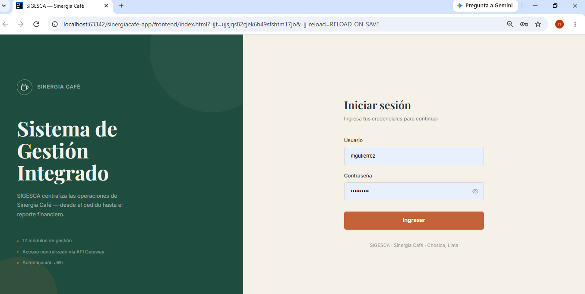
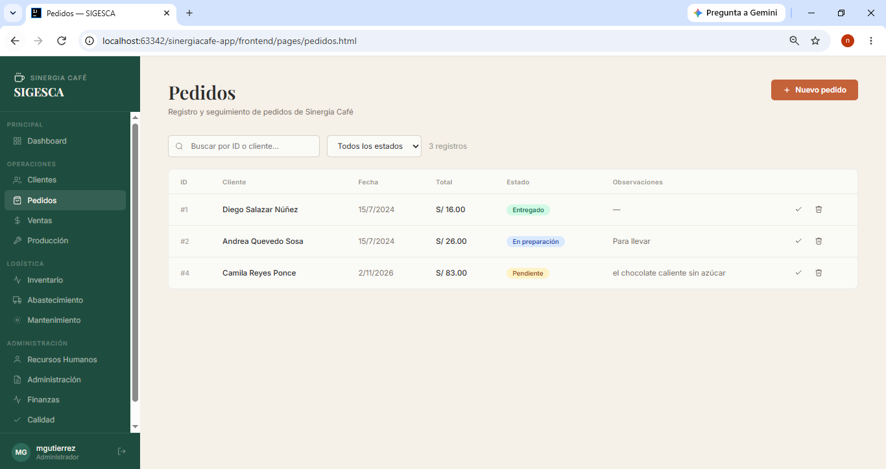
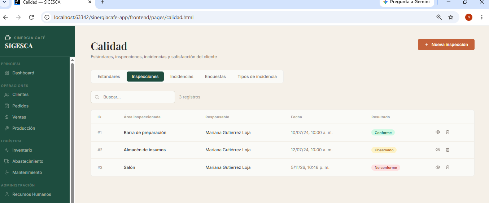
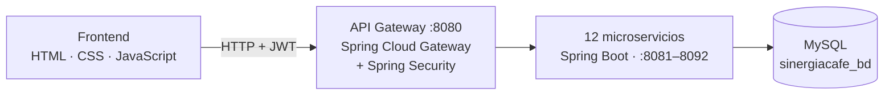

# ☕ Sinergia Café — SIGESCA

**Sistema de gestión integral para una cafetería, construido con arquitectura de microservicios.**


## Descripción

SIGESCA centraliza las operaciones de una cafetería: desde que un cliente hace un pedido hasta el reporte financiero del mes. El backend está dividido en **12 microservicios** independientes, uno por área del negocio, expuestos a través de un **API Gateway** que autentica con **JWT**. El frontend es una aplicación web de administración que consume esa API.

## Capturas

| Inicio de sesión | Dashboard |
|---|---|
|  |  |

| Creación de un pedido con sus productos | Inspección de calidad |
|---|---|
|  |  |

## Arquitectura



El navegador solo conoce el gateway. El gateway valida el token en cada petición y la enruta al microservicio que corresponde según la ruta (`/api/v1/clientes/**` → `ms-clientes`, y así con los demás).

## Módulos

| Microservicio | Puerto | Qué gestiona |
|---|---|---|
| `ms-clientes` | 8081 | Clientes, tipos de cliente, historial de visitas, programas de fidelización y puntos |
| `ms-pedidos` | 8082 | Pedidos, detalle de pedidos y estados |
| `ms-produccion` | 8083 | Recetas, insumos y categorías de insumo |
| `ms-ventas` | 8084 | Comprobantes, cajas, cierres de caja y métodos de pago |
| `ms-inventario` | 8085 | Productos, stock y movimientos de stock |
| `ms-abastecimiento` | 8086 | Proveedores, contratos, órdenes de compra y recepciones |
| `ms-mantenimiento` | 8087 | Equipos, tipos de equipo y mantenimientos |
| `ms-recursoshumanos` | 8088 | Empleados, cargos, turnos, asistencias y evaluaciones |
| `ms-administracion` | 8089 | Documentos administrativos, gastos y categorías de gasto |
| `ms-finanzas` | 8090 | Presupuestos, cuentas por pagar y reportes financieros |
| `ms-calidad` | 8091 | Estándares, inspecciones, incidencias y encuestas de satisfacción |
| `ms-marketing` | 8092 | Campañas y promociones |
| `api-gateway` | 8080 | Punto de entrada único, autenticación JWT y enrutamiento |

## Tecnologías

- **Backend:** Java 21, Spring Boot 3.5, Spring Data JPA (Hibernate), Spring Security, Spring Cloud Gateway (WebMVC), JJWT, Lombok, Jakarta Validation, Maven
- **Base de datos:** MySQL 8 (55 tablas)
- **Frontend:** HTML, CSS y JavaScript sin frameworks, con una hoja de estilos y un componente de navegación compartidos
- **Herramientas:** IntelliJ IDEA, Postman, Git y GitHub

## Cómo ejecutarlo

### Requisitos

JDK 21, Maven, MySQL 8 y un servidor estático para el frontend (el servidor integrado de IntelliJ o `npx serve`).

### 1. Base de datos

Ejecuta el script `database/sinergiacafe_bd.sql` en MySQL. Crea la base `sinergiacafe_bd` con sus 55 tablas y datos de ejemplo. Los microservicios se conectan a `localhost:3306` con el usuario `root` y la contraseña `root`; si tu instalación usa otras credenciales, cámbialas en el `application.yaml` de cada módulo.

### 2. Microservicios y gateway

Levanta primero los 12 microservicios y al final `api-gateway`, ejecutando la clase `Ms…Application` de cada módulo desde el IDE, o con Maven desde la carpeta de cada uno:

```bash
cd ms-clientes
mvn spring-boot:run
```

Cuando cada servicio muestre `Tomcat started on port …`, el sistema está listo.

### 3. Frontend

Sirve la carpeta `frontend` desde un servidor local (no la abras con doble clic, porque el navegador bloquea las peticiones desde `file://`):

```bash
npx serve frontend
```

Abre `index.html` e inicia sesión con el usuario de demostración:

| Usuario | Contraseña |
|---|---|
| `mgutierrez` | `Admin2024*` |

El **dashboard** muestra el estado de los 12 microservicios en tiempo real, con un punto verde por cada uno que responde.

## Ejemplo de uso de la API

```bash
# 1. Obtener el token
curl -X POST http://localhost:8080/api/v1/auth/login \
  -H "Content-Type: application/json" \
  -d "{\"username\":\"mgutierrez\",\"password\":\"Admin2024*\"}"

# 2. Consultar clientes con el token
curl http://localhost:8080/api/v1/clientes -H "Authorization: Bearer <token>"
```

Todas las respuestas siguen el mismo formato:

```json
{ "success": true, "message": "OK", "data": [ ... ] }
```

## Estructura del repositorio

```
sinergiacafe-app/
├── api-gateway/          Gateway, seguridad y filtro JWT
├── ms-clientes/          ┐
├── ms-pedidos/           │
├── ...                   │  12 microservicios, cada uno con sus capas:
├── ms-marketing/         ┘  controller · service · repository · entity · dto · exception
├── frontend/             Aplicación web (index.html, pages/, css/, components/)
├── database/             Script SQL de la base de datos
└── docs/                 Capturas y documentación
```

## Decisiones de diseño

- **Autenticación centralizada en el gateway.** El token se valida en un solo lugar y los microservicios no repiten esa lógica.
- **Una base de datos con separación lógica.** Cada microservicio solo accede a sus tablas, y las relaciones entre servicios se guardan como identificadores (`idCliente`, `idProducto`…) en lugar de claves foráneas de JPA, para que los módulos no dependan unos de otros.
- **Capas y contratos uniformes.** Todos los servicios usan controlador, servicio (interfaz e implementación), repositorio y DTOs separados de las entidades, con validaciones en los DTOs de entrada, una respuesta genérica `ApiResponse<T>` y un manejador global de excepciones.
- **Frontend sin framework.** Reutiliza una hoja de estilos y un componente de navegación comunes, de modo que cada página solo contiene su lógica propia.

## Limitaciones y próximos pasos

Es un proyecto académico, y tiene límites que conviene tener claros:

- El usuario del login está fijo en el gateway; las tablas de usuarios, roles y permisos existen en la base de datos pero aún no están integradas con la autenticación.
- Algunas operaciones que abarcan varios registros (por ejemplo, crear un pedido con sus productos) se hacen en pasos consecutivos desde el frontend, sin una transacción distribuida.
- Los microservicios no validan el token por sí mismos: confían en que el tráfico llega a través del gateway.
- Hay pocas pruebas automatizadas y no se incluye configuración de Docker.
- Como mejoras naturales: autenticación real con roles, comunicación entre servicios (por ejemplo, que recibir mercadería actualice el stock), pruebas de integración y despliegue con contenedores.

## Equipo

- Cabrera Rodríguez, Sibel Del Carmen
- Coral Lock, Nicolas Fabrizzio
- Huaman Solis, Gean

Proyecto desarrollado para el curso **Integración de Aplicaciones** — ISIL, Lima.